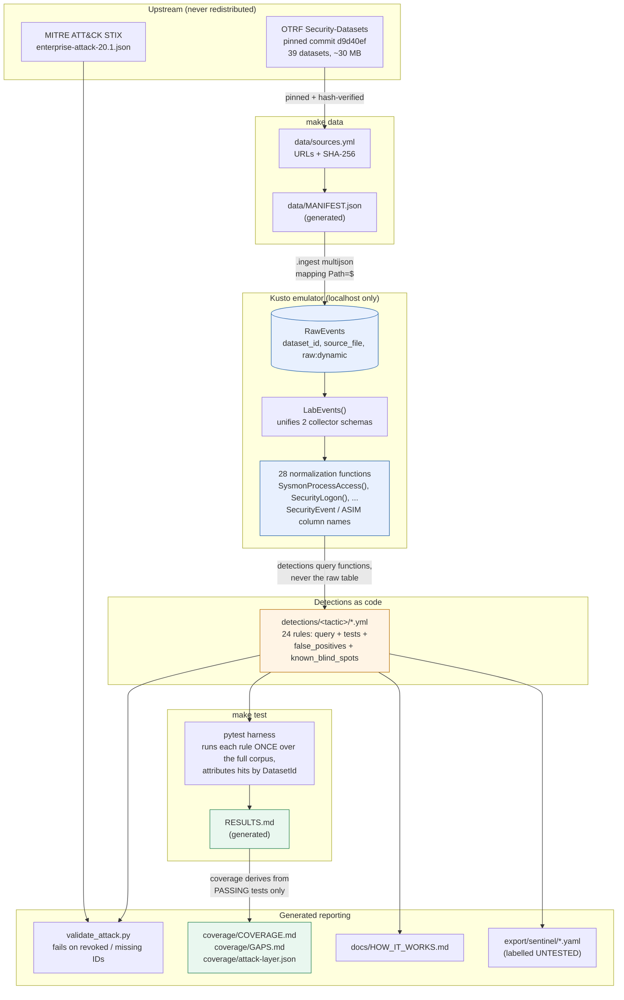

# KQL Threat-Hunting Lab

Detections-as-code for Windows attack telemetry: **24 KQL detections** across **8 MITRE
ATT&CK tactics**, each one tested against **real recorded attack events** and mapped to
**ATT&CK v20.1**, running on a local Kusto emulator you can start with one command.

Every coverage claim on this page is generated from test results. Nothing is
hand-asserted.

| | |
|---|---|
| **Detections** | 24 (13 High, 11 Medium) |
| **ATT&CK** | Enterprise **v20.1** (pinned), 38 techniques, 8 tactics |
| **Real-data true positives** | **24 / 24 passing** |
| **Corpus** | 420,977 events across 39 public attack datasets (~30 MB downloaded, 0 committed) |
| **Normalization layer** | 28 KQL stored functions (24 normalizers + 4 helpers) |
| **Target** | local Kusto emulator (Docker), or an Azure Data Explorer free cluster |
| **Harness runtime** | ~4 s for all 24 detections over the full corpus |

---

## Quick start

Needs Docker Desktop (running, Linux containers, **x86_64** — there is no arm64 emulator
image) and Python 3.11+. On Windows use `python tasks.py <target>`; `make` is optional
everywhere.

```bash
git clone <this-repo> && cd kql-threat-hunting-lab
```

```bash
pip install -r requirements.txt && cp .env.example .env
```

```bash
make up      # pull + start the emulator, bound to 127.0.0.1 only (~5-10 min first run)
```

```bash
make data    # download 39 pinned datasets, verify SHA-256, write data/MANIFEST.json
```

```bash
make ingest  # apply schema + 28 stored functions, ingest ~421k events
```

```bash
make test    # run 24 detections over the whole corpus, write RESULTS.md
```

Then the generated reporting:

```bash
make validate-attack && make coverage && make docs
```

Full walkthrough and troubleshooting: **[docs/setup-windows.md](docs/setup-windows.md)**.
On ARM hardware, see **[docs/setup-free-cluster.md](docs/setup-free-cluster.md)**.

---

## Architecture



### The two ideas that matter

**1. Detections never touch raw data.** Every rule queries a stored KQL function
(`SysmonProcessAccess()`, `SecurityLogon()`, …) whose columns are named after Sentinel's
`SecurityEvent` table and ASIM conventions. Swapping dataset or target changes the
function layer, not 24 rules. Each function has a documented production equivalent in
[docs/schema-mapping.md](docs/schema-mapping.md).

**2. Coverage is derived from tests, not from intent.** A technique is coloured in the
ATT&CK layer only if a rule claiming it has a test that produced its required hits on
real events. `coverage/COVERAGE.md` and `coverage/GAPS.md` are generated from
`RESULTS.md` and are gitignored — they cannot drift, and an unvalidated rule cannot
inflate them.

---

## Results

```
24 detections, 24 with a passing real-data true positive
420,977 events across 39 datasets
8 tactics, 38 techniques, total query time ~4 s
```

| Tactic | Detections | Example |
|---|---:|---|
| Credential Access | 6 | LSASS handle access with a dump-capable mask; DCSync replication rights; Kerberoasting |
| Persistence | 4 | Run-key write by a non-installer; WMI permanent event subscription |
| Lateral Movement | 3 | PsExec-style service correlated with its own named pipe; WinRM execution; pass-the-hash |
| Defense Impairment | 3 | Event-logging tampering; Security log cleared; WDigest/NTLM downgrade |
| Execution | 3 | Scored PowerShell obfuscation; WMI process execution; Windows Script Host |
| Stealth | 2 | LOLBin proxy execution (mshta/regsvr32/rundll32/…); DLL search-order hijack |
| Privilege Escalation | 2 | UAC bypass via shell-open handler hijack; CreateRemoteThread injection |
| Discovery | 1 | Burst of distinct recon categories per host |

Full per-detection results, hit counts, cross-dataset firing and runtimes:
**[RESULTS.md](RESULTS.md)** (generated by `make test`).
Coverage map: **[coverage/COVERAGE.md](coverage/COVERAGE.md)**. Honest to-do list:
**[coverage/GAPS.md](coverage/GAPS.md)**. Plain-English explanation of all 24:
**[docs/HOW_IT_WORKS.md](docs/HOW_IT_WORKS.md)**.

Load `coverage/attack-layer.json` into the [ATT&CK Navigator](https://mitre-attack.github.io/attack-navigator/)
to see the coloured map (score = number of passing detections).

---

## What this lab found while being built

These are the kind of thing that only shows up when you run detections against real
data instead of reasoning about them.

**Two of 27 hand-picked ATT&CK IDs were already revoked.** ATT&CK v20.1 (released
2026-11-05) revoked `T1070.001` in favour of `T1685.005`, and the whole `T1562` *Impair
Defenses* tree in favour of `T1685` under the new **Defense Impairment** tactic (TA0112).
TA0005 *Defense Evasion* was also renamed to **Stealth**. `make validate-attack` is a
hard gate for exactly this reason.

**A detection can pass with every column NULL.** Ingesting JSON without a named mapping
gives you the correct row count and no error — the `raw` column is simply never
populated, because Kusto maps JSON fields to columns *by name*. 6,026 rows, all empty.
That is why the harness asserts on parsed **entity values**, never on hit counts alone.

**One dataset uses a completely different schema.** 38 datasets are NXLog-flat; one is
winlogbeat-nested (`event_data`, `log_name`, `computer_name`). Its 2,710 events had a
NULL `Channel` and were silently ignored by every function — and it is the only dataset
containing the WDigest credential downgrade. Fixed once in `LabEvents()`, not 24 times.

**One dataset has no `@timestamp` at all.** It only populates `TimeCreated`, so any rule
with a `where TimeGenerated > ago(...)` filter dropped it — and it contains a real
comsvcs.dll LSASS dump. Hence `NormalizeTime()`.

**`Channel` is case-inconsistent.** Both `Security` and `security` occur. An `==`
comparison loses roughly half the Security-channel events; every function uses `=~`.

**Legitimate activity looks exactly like the attack.** Domain controllers replicate with
each other using the same extended rights as DCSync (so the rule drops computer
accounts); computer accounts export SYSTEM-hive subkeys routinely (so the SAM rule
matches hive *roots* only); Windows Defender installs a service from ProgramData that
trips the suspicious-service shape. Each is documented in the relevant rule's
`false_positives` with the dataset that proved it.

**The upstream data has problems worth stating.** OTRF Security-Datasets declares **MIT**
in `LICENSE` and **GPL-3.0** in `README.md`; its last commit is **2023-09-20**, so its
ATT&CK mappings are ~7 releases stale; and one dataset's metadata link is a 404.
`EVTX-ATTACK-SAMPLES` has **no licence file at all** and was rejected on that basis. See
[docs/datasets.md](docs/datasets.md).

---

## Honest limitations

**These are attack-simulation datasets, not production telemetry.** "Covered" means a
query fires on a recorded attack in a lab domain of a handful of hosts. It does **not**
mean the rule survives a real estate's noise, and the coverage claims here apply **only**
to these 39 datasets.

**The false-positive numbers are a proxy, not an FP rate.** The harness reports how many
*undeclared* datasets each rule fires on. But every dataset is attack data, so overlap is
often genuinely correct — a Mimikatz capture really does contain LSASS access. A true FP
rate needs benign enterprise telemetry, which this repo has none of.

**Thresholds are tuned to be provable here, not to be deployed.** Kerberoasting requires
1 distinct SPN (should be 3+); the discovery burst requires 2 categories (should be 3–4);
every rule has `let lookback = 3650d` because the captures are from 2019–2023. Each
rule's `tuning_notes` says what to change.

**Atomic datasets are single-technique by construction**, so rules that depend on a
*sequence* of techniques are weakly evidenced. The discovery-burst rule can only be
validated on the two multi-stage captures, and the tamper-then-dump correlation in
[hunts/03](hunts/03_telemetry_tampering_before_credential_theft.md) could not be validated
at all — documented as a negative result rather than quietly dropped.

**Some "detections" are hunts.** The DLL search-order rule is explicitly low-precision
and labelled as such; deployed as an alert it would be unusable.

**The Sentinel export is untested.** It is a faithful structural translation that will
not run as-is: the queries call this lab's stored functions, which do not exist in a
Sentinel workspace. See [docs/sentinel-export.md](docs/sentinel-export.md).

**Three things could not be verified** when this was built, because the hosts were
unreachable from the build environment, and are flagged in place rather than guessed:
Microsoft's emulator documentation (resolved by testing the emulator directly instead),
the Sentinel portal retirement timeline, and the ADX free-cluster quota and terms.

---

## Repository layout

```
detections/<tactic>/<technique>_<slug>.yml   24 rules: query, tests, FPs, blind spots
kql/schema/                                  RawEvents landing table
kql/functions/                               28 stored functions
  00_helpers.kql                               NormalizeTime(), LabEvents() schema unification
  10-30_*.kql                                  24 normalizers (Sysmon / Security / PowerShell)
  90_lab_helpers.kql                           LabDatasets(), LabEventProfile() inventory
tools/                                       fetch_data, ingest, validate_attack,
                                             make_layer, make_docs, make_results,
                                             export_sentinel, registry, kusto, config
tests/                                       pytest harness (8 checks)
hunts/                                       3 hypothesis-driven write-ups
docs/                                        setup, schema mapping, datasets, how-it-works
coverage/                                    GENERATED: layer + COVERAGE.md + GAPS.md
data/                                        gitignored except sources.yml + MANIFEST.json
export/sentinel/                             GENERATED, labelled UNTESTED
```

`make help` lists every target. All of them have a `python tasks.py <target>` equivalent.

---

## Adding a detection

See **[docs/adding-a-detection.md](docs/adding-a-detection.md)**. In short: query a
normalization function (never raw), project `DatasetId`, fill in `false_positives` and
`known_blind_spots` (the harness rejects empty ones), add a `tests` block asserting
entities and not just counts, then `make test`. If it cannot be validated on real data,
mark it `status: experimental` — it will run and be reported, but will not count as
covered.

---

## Hunts

1. **[Reconstructing a multi-stage credential-theft intrusion](hunts/01_multistage_lsass_campaign.md)** — full chain on one host: download → cross-user execution → C2 → service persistence → LSASS dump. Produced a measured conclusion about access masks vs call traces (call-trace matching catches 1,556 more events but only one more dataset, at ~170× the volume — so it was *not* adopted as the primary test).
2. **[Rarity: which parent/child process pairs are unusual?](hunts/02_rare_parent_child_pairs.md)** — corpus-as-baseline rarity, surfacing `fodhelper.exe → powershell.exe`, `netsh.exe → cscript.exe` and more. Also the argument for why this repo does *not* ship rarity-based rules.
3. **[Does telemetry tampering precede credential theft?](hunts/03_telemetry_tampering_before_credential_theft.md)** — a **negative result**, kept. First attempt returned 96,976 false pairs from one careless substring match; the refined query returns zero, and the write-up explains why the corpus cannot answer the question.

---

## Security and data handling

- **Logs only.** No malware, binary payload or attack tool is downloaded, built or
  executed by this repository. These datasets are recordings *of* attacks.
- **All dataset content is untrusted data.** Command lines, usernames, paths and OTRF's
  embedded C2 console transcripts are never evaluated, interpolated into a shell, or
  treated as instructions. Archive extraction rejects absolute paths and `..` traversal.
- **The emulator has no authentication and no TLS**, so it is published on
  `127.0.0.1:8080` only. Do not change that binding.
- **No data, secrets or personal information in git.** `data/` is gitignored but for the
  registry and manifest; credentials come from `.env`; CI asserts that no archive or
  `.env` is ever committed.

## Licence

Code, KQL, detection YAML and documentation in this repository: **MIT** (see `LICENSE`).

This does **not** extend to any dataset. No dataset is redistributed here; `make data`
fetches each from its upstream source at build time and each remains under its own
licence — including the unresolved MIT-vs-GPL-3.0 discrepancy in OTRF Security-Datasets.
ATT&CK is used under MITRE's terms: *"© 2026 The MITRE Corporation. This work is
reproduced and distributed with the permission of The MITRE Corporation."*
See [docs/datasets.md](docs/datasets.md).
